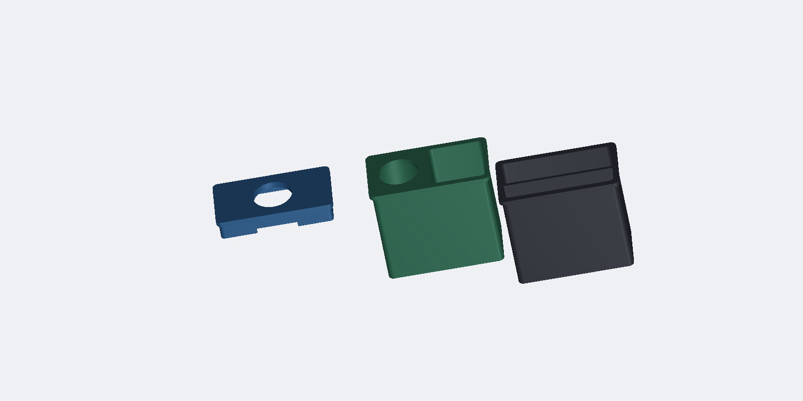

# 1994–2004 Chevy S10 & GMC Sonoma 3D Printed Accessories

A complete collection of custom, functional 3D printable upgrades designed specifically for **1994–2004 Chevrolet S10, GMC Sonoma, S10 Blazer, GMC Jimmy, and Oldsmobile Bravada** trucks and SUVs. 

Engineered and field-tested on a **1995 GMC Sonoma** (former City of Wenatchee municipal fleet truck) with factory 60/40 split bench seats.

  

  
  

  
  

---

## 🌐 Interactive 3D STL Web Inspector

Spin, pan, zoom, and inspect every model and assembly in your browser with smooth studio lighting and wireframe toggles:
* Open [`viewer.html`](viewer.html) locally or visit `http://localhost:8766/viewer.html` if the local server is running.
* **100% Offline & Private:** Built with self-contained local Three.js bundles in `js/` (zero CDNs or external network dependencies).

---

## 🚗 Vehicle Compatibility

* **1994–2004 Chevrolet S10** (Regular Cab, Extended Cab, Crew Cab)
* **1994–2004 GMC Sonoma**
* **1995–2005 Chevrolet Blazer / S10 Blazer**
* **1995–2001 GMC Jimmy**
* **1996–2001 Oldsmobile Bravada**

---

## 📦 What's Included

### 1. Dashboard Phone Mount System (17mm Ball / MagSafe / Garmin)
Located in [`stls/phone_mount/`](stls/phone_mount/)

Designed to replace the factory blanking plate / switch bezel on the dashboard to the right of the instrument cluster:

* **`sonoma_plate_monolithic_ball.stl` & `sonoma_plate_monolithic_symmetrical.stl`**:
  * **Zero Hardware Needed.** Fuses the OEM snap plate and a 17mm ball mount into a single monolithic print.
* **`sonoma_plate_metal_ball.stl` & `sonoma_plate_metal_ball_symmetrical.stl`**:
  * Designed for heavy-duty metal 17mm ball studs with a standard **1/4"-20 threaded post**.
  * Features a molded rear captive hex-nut pocket (11.5mm flats, 6mm depth) inside the reinforced boss.
* **`sonoma_plate_printed_ball.stl` & `ball_17mm_frontmount.stl`**:
  * **Front-Serviceable 2-Piece System.** Uses two front-mounted counter-bored M3 / #6 screws with captive rear nuts.
  * Allows swapping or servicing ball mounts without removing the dashboard trim bezel!

---

### 2. Dual Stepped Bench Seat Cupholder (Large Bottle & Stanley Mug)
Located in [`stls/cupholder/`](stls/cupholder/)

Solves the infamous lack of functional cupholders in 90s GM bench seat trucks:

* **`sonoma_cupholder_deck.stl`**:
  * Slides into the factory center bench seat receiver slot with a positive retention catch bump.
  * **Triple-stepped bore** holds everything from standard 12oz soda cans (2.75" bottom pocket) to Stanley 30oz/40oz tumblers, Hydro Flasks, and YETI 35oz mugs.
  * Outward-facing handle clearance notches for large travel mugs.
* **`sonoma_glide_stilt.stl`**:
  * Heavy-duty ribbed compression stilt leg that presses into the keyed socket beneath the deck.
  * Features a curved glide foot contoured to the factory transmission tunnel hump, keeping drinks completely level and rock solid under heavy braking.
  * Includes a recessed pocket on the bottom for a 1.5" felt or rubber pad to protect carpet.

---

### 3. Modular Magnetic Deep Glasses Cubby Ecosystem
Located in [`stls/dash_cubby/`](stls/dash_cubby/)

Upgrades the factory dash cavity into a deep, modular sunglasses vault with swappable magnetic faceplates:

* **`S10_cubby_magnetic_dock.stl` (140mm Deep Glasses Spec — Recommended)**:
  * Engineered with a **136.5mm internal cavity depth** (140mm total outer depth).
  * **The Sweet Spot for Glasses:** Comfortably swallows full-sized folded sunglasses (Ray-Bans, Oakleys, aviators) end-to-end, while stopping 7mm shy of the internal dashboard firewall/climate ducting so it never bottoms out behind the dash.
  * Features 4 corner boss pads with 6.3mm × 3.2mm pockets for **6mm × 3mm round neodymium disc magnets**, plus an 18mm × 10mm rear cable pass-through port.
* **`S10_cubby_magnetic_dock_147mm.stl` (147.2mm Ultra-Deep Spec)**:
  * Maximum theoretical depth matching the original `S10_glasses_cubby_deep.stl` for trucks with full rear cavity clearance.
* **`S10_cubby_mag_ball_plate.stl` (Magnetic 17mm Ball Mount Plate)**:
  * Snaps firmly onto the magnetic dock with 4 matching neodymium magnets.
  * Features a rigid 17mm ball mount stud on a reinforced keel, tilted 15° upward toward the driver.
  * Allows popping off in one second with the bottom finger notch to access your sunglasses, then snapping right back on!
* **`S10_cubby_mag_stealth_cover.stl` (Flush OEM Stealth Stash Lid)**:
  * Completely conceals the deep cubby behind a factory-looking blank bezel with a bottom finger-lift notch.
  * 4 rear magnet pockets are hidden behind a 0.3mm solid front skin, creating an undetectable secret stash vault.
  * Inset anti-rattle locating rim keys securely into the cubby opening to prevent any vibration while driving.
* **`S10_cubby_mag_magsafe_plate.stl` (Magnetic 15° MagSafe Fast-Charger)**:
  * Holds standard 56mm Apple MagSafe / Qi2 wireless charging pucks tilted 15° toward the driver, with an internal USB-C wiring channel.

#### 🕶️ Classic Open Dash Trays
* **`S10_glasses_cubby_deep.stl`**: Original open full-depth sunglasses box (147mm).
* **`S10_glasses_cubby_angled.stl`**: Original angled sunglasses tray.
* **`S10_dash_cubby.stl`**: OEM replacement insert.

---

### 4. Ashtray Conversions (Power & Storage)
Located in [`stls/ashtray/`](stls/ashtray/)

Replaces the unused factory cigarette ash bin with modern USB-C charging power or dedicated daily-carry storage:

  

  

#### Dash Architecture by Model Year:
* **1994–1997 Models (e.g. 1995 GMC Sonoma Lower Dash Pull-Out Drawer)**: 
  * The factory pull-out drawer is located on the lower dashboard to the right of the cigarette lighter.
  * **Drop-In Bucket Replacement Strategy:** The factory slide-out drawer mechanism and OEM exterior textured faceplate are retained 100% stock when closed. The inner metal cigarette bucket unclips and lifts out, allowing a custom 3D printed organizer pocket or USB-C fast-charging pod to drop directly into the sliding drawer frame!
  * **`sonoma_1995_ashtray_usb_power.stl` (Flush USB-C Fast Charger Pod)**:
    * Replaces the inner metal bucket with a flush top deck fitted with a standard **28.8mm (1-1/8") round mounting hole**.
    * Fits universal automotive/marine dual USB-C Power Delivery (45W/65W) + QC3.0 chargers with LED voltmeters.
    * Chamfered rear wire pass-through channel allows clean cable exit without pinching when sliding the drawer open and closed.
  * **`sonoma_1995_ashtray_edc_pocket.stl` (Deep Everyday Carry Organizer)**:
    * Dual-compartment organizer: deep flat-bottom cargo vault for keys/AirPods/toll badges + forward curved ramp pocket for sliding out coins/screws with your thumb.
  * **`sonoma_1995_ashtray_combo_power.stl` (2-in-1 USB-C Power + Drop Pocket)**:
    * Combines a driver-side 28.8mm USB-C socket with a passenger-side open utility drop pocket.

* **1998–2004 Models (Center Stack Below HVAC)**:
  * Located in the center dash stack. Compatible with both drop-in bin inserts and flush delete pods:
  * **`S10_ashtray_usb_power_panel.stl`**: Center-stack 28.8mm USB-C panel.
  * **`S10_ashtray_deep_pocket.stl`**: Multi-compartment coin/key drop pocket.
  * **`S10_ashtray_combo_power_pocket.stl`**: 2-in-1 hybrid power and storage bin.

---

### 5. 1995 Sonoma Bench Seat Cupholder Upgrades
Located in [`stls/cupholder/`](stls/cupholder/)

  
  

  
  

Calibrated directly against real photos of the **1995 GMC Sonoma** dark blue interior and verified using a **Milwaukee Fastback 6-in-1 (`48-22-1505`)** utility knife (117mm / 4.6" closed) as a physical scale:

* **Real Floor Drop Clearance:** The distance from the seat receiver tongue down to the rubber transmission tunnel floor mat is only **50mm to 60mm (~2.0" to 2.4")**. The bottom of full-depth 82mm cups sits just ~25mm above the floor mat, making the support stilt leg extremely short, rigid, and rock-solid!

#### 🚀 1. The Monolithic Unibody Console (Single-Piece Indestructible Print — Recommended)
Replaces the stock GM blue cupholder console entirely as a **100% single, solid automotive unibody**:

* **`sonoma_1995_monolithic_console.stl`**:
  * **100% Space Utilization & Zero Waste:** Every cubic centimeter of available real estate has been converted into functional storage, eliminating solid plastic dead weight.
  * **Dual 82mm-Deep Stepped Cupholders:** Over **2.3x deeper** than the stock 35mm GM wells! Complete 360° circular solid perimeter walls with a stepped bore (86mm / 3.38" top flare, 70mm / 2.75" lower pocket). Holds standard 12oz soda cans and water bottles firmly without rattle, while easily accommodating 30oz/40oz tumblers (Yeti, Stanley, Hydro Flask).
  * **Dedicated Milwaukee Fastback 6-in-1 Knife Holster:** Precision vertical slot (38mm × 20mm × 55mm deep) with an integrated pocket clip relief channel in the rear center bridge.
  * **Dual Massive Open Rear Cargo Blocks:** Two giant, deep open vault pockets (**60mm W × 22mm L × 60mm D each**) on the driver and passenger rear wings—wide-open multipurpose bins to shove sunglasses, wallets, AirPods, knives, pens, lighters, or tools wherever you want without restrictive dividers.
  * **Contour-Wrapped Forward Cargo Mega-Vault:** Sweeps around the front curves of both cupholders to capture all free space (**172mm W × 67mm L × 32mm D**) with a continuous 45° coin scoop ramp—a massive, deep open bay to shove wallets, sunglasses cases, phones, keys, cords, or tools without cramped slots or wasted plastic.
  * **Reinforced Seat Receiver Tongue with 45° Buttress Gussets:** 
    * Eliminates cantilever bending fatigue when resting heavy tumblers or leaning on the console.
    * Features a heavy-duty **45° triangular buttress gusset** underneath that tapers smoothly from $Y = -78\text{mm}$ down into the vertical rear body wall down to $Z = -77.5\text{mm}$.
    * Taper acts as a self-centering 45° lead-in shoe that slides effortlessly into the seat receiver slot without catching.
    * Features a **45° top transition fillet** that eliminates notch stress concentration where the tongue meets the console deck.
    * Integrated retention catch bump locks securely into the factory GM receiver channel.
  * **Triple Self-Supporting 45° Gable Weight-Relief Coring (Zero Supports Needed):**
    * Hollows out **~500 cm³ of dead solid plastic mass (~620g solid plastic equivalent)** without sacrificing structural rigidity!
    * **Forward Gable Chamber:** $134\text{mm W} \times 46\text{mm L}$ with a 45° gable roof under the front mega-vault.
    * **Rear Gable Chamber:** $112\text{mm W} \times 26\text{mm L}$ with a 45° gable roof under the rear cargo blocks and knife holster.
    * **Central Longitudinal Spine Tunnel:** $18\text{mm W} \times 74\text{mm L}$ with a 45° peaked arch connecting the front and rear chambers between the lower cupholder pockets.
    * **100% Self-Supporting:** Every ceiling overhang angle is exactly 45°—the entire console prints with **ZERO internal or external supports**, saving **~300g of filament** and **4 to 6 hours of print time**!
  * **Integrated Transmission Tunnel Glide Base:** Extends straight down to $Z = -110\text{mm}$ with a continuous perimeter box frame and a 320mm radius contoured arch matching the transmission tunnel carpet, complete with dual 40mm recessed pockets for anti-slip rubber or felt pads.

#### 🧩 2. The Modular 2-Piece Edition (For Smaller Print Beds):
* **`sonoma_cupholder_1995_megadeck.stl`**:
  * The same full-feature console deck, stopping at $Z = -85\text{mm}$ with an underside mortise socket for printers with restricted vertical build volume.
* **`sonoma_cupholder_1995_stilt_26mm.stl` (25mm Low-Profile Stabilizer Foot)**:
  * Bridges the 25mm gap from the bottom of the deck down to the transmission tunnel hump, with a precision tenon that keys firmly into the underside socket.

#### 🛠️ 3. OEM Dual-Well Drop-In Inserts (Zero Disassembly Option):
* **`sonoma_cupholder_tumbler_sleeve.stl` (30/40oz Stanley & Yeti Riser)**:
  * Drops directly into either factory blue cup well.
  * Features a 35mm lower seating collar that locks into the OEM well, rising 50mm above the console with a **stepped 3.25" / 3.62" bore** and a wide outward **mug handle slot**.
* **`sonoma_cupholder_fastback_caddy.stl` (Milwaukee Fastback + Phone Caddy)**:
  * Drops into one of the blue wells to convert it into a specialized EDC workstation.
  * Features a precision **vertical pocket custom-molded for the Milwaukee 48-22-1505 Fastback knife** plus a smartphone / battery bank slot.
* **`sonoma_glide_stilt_52mm.stl`**:
  * Calibrated 52mm stilt leg for the original flat-deck cupholder.

---

### 6. 💡 Dashboard & Glove Box LED Bulb Upgrade Guide

The factory incandescent miniature wedge bulbs in the lower dash ashtray and the passenger glove box drawer often burn out or emit a dim yellow glow. Both can be easily upgraded to high-efficiency, bright LEDs.

#### 📐 Bulb Specifications:
* **Lower Dash Ashtray Light:** **#161 or #194 (T10 / W5W miniature wedge base)** (12V, push-in wedge).
* **Passenger Glove Box Drawer Light:** **#194 (T10 / W5W miniature wedge base)** (12V, push-in wedge).
* **Recommended Replacement:** High-quality CANBus-friendly **T10 / 194 LED wedge bulbs** (available in Warm White 3000K for an OEM look, Cool White 6000K for modern clarity, or Dark Blue to complement the factory Sonoma blue interior).

#### 🔧 Step-by-Step Replacement:
1. **Ashtray Night-Light:**
   * Slide the ashtray drawer out. Press down on the top spring release tab and pull the inner bucket out.
   * Look directly into the upper ceiling of the inner dash cavity. You will see a small twist-lock plastic socket.
   * Twist the socket **1/4 turn counterclockwise** to unlock and pull it down.
   * Pull the old glass #161/#194 bulb straight out of the wedge socket. Push the new LED bulb straight into the socket.
   * **Polarity Check:** Turn on your parking lights. If the LED doesn't illuminate, pull it out, **flip it 180 degrees**, and reinsert (LED diodes are polarity-sensitive).
   * Twist the socket clockwise 1/4 turn back into the housing ceiling.
2. **Passenger Glove Box Drawer Light:**
   * Open the glove box door. Locate the striker/light assembly on the upper frame.
   * Gently squeeze the plastic diffuser lens tabs to release the lens cover.
   * Pull the old #194 wedge bulb straight out and push the new LED in.
   * Verify illumination when opening the glove box door (flip 180° if needed), then snap the lens cover back into place.

## ⚡ Step-by-Step Ashtray & Cigarette Lighter Wiring Guide

Because the factory 12V cigarette lighter is located right next to the ashtray, you have clean, direct access to power without running wires through the firewall.

### 🔍 GM Factory Wire Identification:
When you pull the lower dash trim / center bezel forward to access the back of the lighter socket, you will see two or three factory wires:
1. **ORANGE (12–14 AWG thick wire)**: **Constant 12V+ Battery Power** (Hot at all times, even with key out of the ignition). Protected by the 20A / 25A `CIG` or `AUX PWR` fuse in the driver's side fuse panel.
2. **BLACK (16–18 AWG wire)**: **Chassis Ground (12V-)**. *(Note: On some S10s, the lighter grounds directly through its outer metal collar or metal dash bracket; in that case, ground your new USB charger to any metal bolt on the dash frame).*
3. **GRAY (18 AWG thin wire, if equipped)**: **Dash Illumination (12V+)**. Only powers the tiny factory light bulb when headlights or parking lights are turned ON. *(Do NOT use this wire to power your USB charger—it cannot support the amperage and will blow the instrument cluster fuse).*

---

### 🛠️ Wiring Options: Constant Power vs. Ignition-Switched

#### Method A: Tapping the Factory Cigarette Lighter (Constant 12V Power — Easiest)
* **How it works:** Connect the USB socket's `(+)` terminal to the factory **ORANGE** wire using an insulated T-Tap or solder-and-heat-shrink splice. Connect `(-)` to the **BLACK** wire (or a ring terminal to a nearby dash bolt).
* **Advantage:** Your phone or MagSafe charger charges even when the truck is parked and the key is in your pocket (great for camping, road trips, or quick errands).
* **Important Precaution:** If you buy a USB socket with an always-on LED voltmeter, it will draw a tiny "vampire" standby current (approx 15–25mA). While negligible for a daily driver, if the truck sits parked for 3–4 weeks, it can slowly discharge the battery. **Recommendation:** Buy a USB socket that has an integrated **touch on/off switch** on the front lens so you can turn the display off when parked!

#### Method B: Ignition-Switched 12V (Turns ON/OFF with the Key — Recommended for Voltmeter Sockets)
If you want the charger and voltmeter display to shut off 100% when you turn off the truck:
1. Open the driver's side dash fuse box (accessible with the driver door open).
2. Use a standard **Add-a-Circuit / Add-a-Fuse tap** (ATO or Mini fuse depending on your year) into an ignition-switched fuse slot (such as `WPR` Windshield Wipers or `RADIO`).
3. Insert the original fuse into the bottom slot of the tap, and a **10A fuse** into the top slot for your new USB charger.
4. Route a single 16 AWG power wire from the tap, behind the knee bolster, and into the center ashtray cavity. Connect to the `(+)` terminal of the USB socket.
5. Connect the `(-)` terminal to any clean metal screw or bolt on the inner dash frame.

---

## 🔩 Hardware Required (Optional Depending on Module)

* **For Magnetic Cubby Faceplates:**
  * 4x to 8x standard **6mm diameter × 3mm thick round neodymium disc magnets** (Grade N50 or N52 recommended for maximum holding power). Press-fit with a dab of superglue / CA glue.
* **For Metal Ball Phone Mount:**
  * 1x 17mm metal ball stud with 1/4"-20 threaded shank and matching 1/4"-20 hex nut.
* **For 2-Piece Serviced Mount:**
  * 2x M3 × 16mm socket head cap screws and 2x M3 hex nuts.

---

## 🖨️ Recommended Print Settings

> [!IMPORTANT]
> **Material Warning:** Because car interiors in the summer can easily exceed **60°C to 70°C (140°F – 160°F)**, **DO NOT USE STANDARD PLA**! PLA will deform, soften, and warp in hot vehicles.

* **Recommended Filament:** **PETG**, **ABS**, or **ASA** (ASA is ideal for UV and heat resistance).

### 🚀 Monolithic Console Slicing Guide (Maximum Strength, Minimum Time & Filament)
* **Print Orientation:** Flat on build plate (Z up).
* **Supports:** **DISABLED / OFF**! (All cavity ceilings, bevels, and buttresses are 45° self-supporting).
* **Layer Height:** 
  * `0.28mm` (Fast profile with standard 0.4mm nozzle) — cuts print time by **~40%** vs 0.20mm while looking great.
  * `0.32mm` or `0.36mm` (with 0.6mm nozzle) — cuts print time by **~60%** (prints in ~10–12 hours instead of 28 hours!).
* **Perimeters / Wall Line Count:** `3 to 4 walls` (1.2mm to 1.6mm wall thickness).
  * *Strength Tip:* In 3D printing mechanics, >90% of bending and impact resistance comes from outer perimeters. 3–4 walls provide extreme structural rigidity.
* **Infill:** `12% to 15% Gyroid` or `Adaptive Cubic / Lightning`.
  * *Filament Saver:* Higher infill (e.g. 40–50%) wastes hundreds of grams of filament and adds 10+ hours without contributing meaningful real-world strength. 15% Gyroid provides uniform 3D compression resistance.

### 📱 Dash Phone Mounts & Ashtray Inserts
* **Layer Height:** `0.20mm` (or `0.16mm` for ball studs).
* **Perimeters / Walls:** `4 to 5 walls` (Crucial for mechanical strength on phone ball stems).
* **Infill:** `25% to 40% Gyroid`.
* **Supports:**
  * Phone plates: Print flat face-down on build plate. Supports required only under the rear snap tabs.
  * Ball stud (`ball_17mm_frontmount.stl`): Print oriented on its flat side for maximum layer adhesion strength along the stem axis.
  * Ashtray inserts: Print right-side up with 0 supports.

---

## 💻 Parametric CAD Source Code

All parts were programmatically designed in Python using the modern `manifold3d` geometric modeling engine. Source scripts are in [`src/`](src/):
* `src/generate_monolithic_console.py`: 1995 Sonoma Monolithic Unibody Console & 25mm stilt generator.
* `src/generate_1995_sonoma_cupholder_console.py`: 1995 Sonoma Mega-Deck console & 26mm stabilizer stilt generator.
* `src/generate_1995_sonoma_mods.py`: 1995 Sonoma ashtray drop-ins, tumbler sleeve, Fastback caddy, and 52mm stilt generator.
* `src/generate_all_phone_mounts.py`: Parametric phone mount generator.
* `src/generate_sonoma_cupholder.py`: Bench cupholder and original stilt generator.
* `src/generate_cubby_mods.py`: Modular magnetic dash cubby and accessories generator.
* `src/generate_ashtray_mods.py`: Ashtray power panel and deep pocket conversion generator.
* `src/render_1995_sonoma.py`: Studio CAD rendering script for 1995 Sonoma models.
* `src/render_smooth_cad.py`: Phong studio CAD rendering pipeline.
* `src/export_symmetrical_mounts.py`: Symmetrical plate exports.

You can modify cup diameters, stilt drop heights, or ball tilt angles directly in the Python scripts!

---

## 📄 License

This project is licensed under the [MIT License](LICENSE) — free to print, modify, and share.
