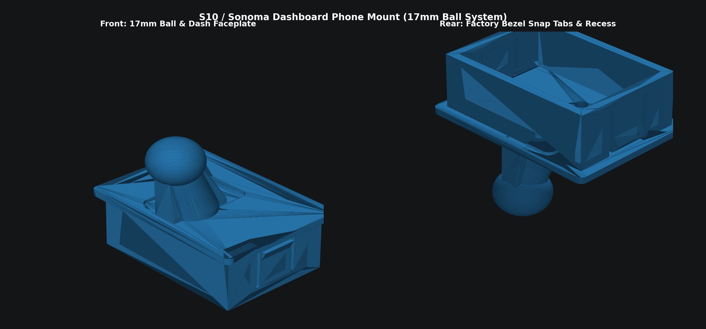
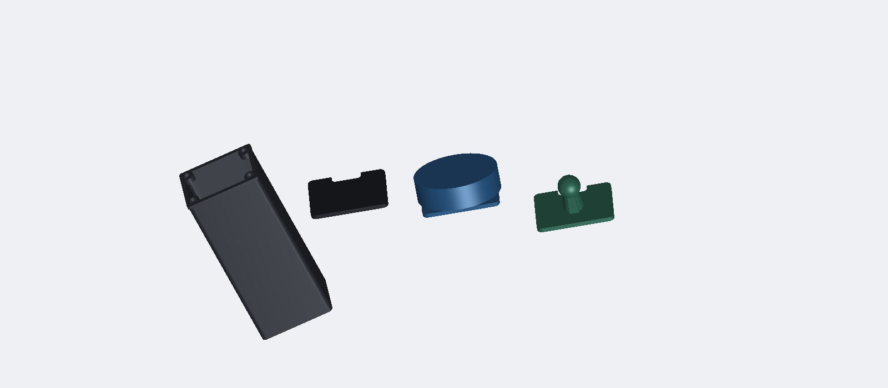
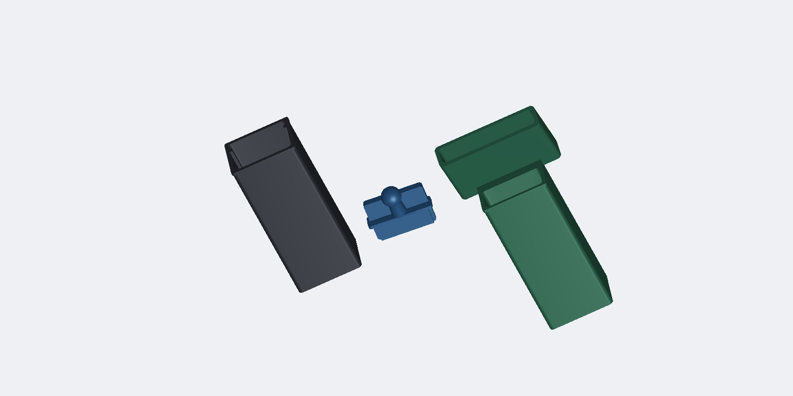
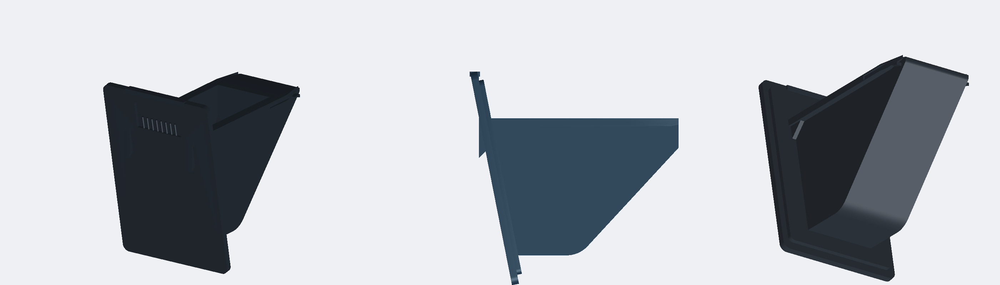
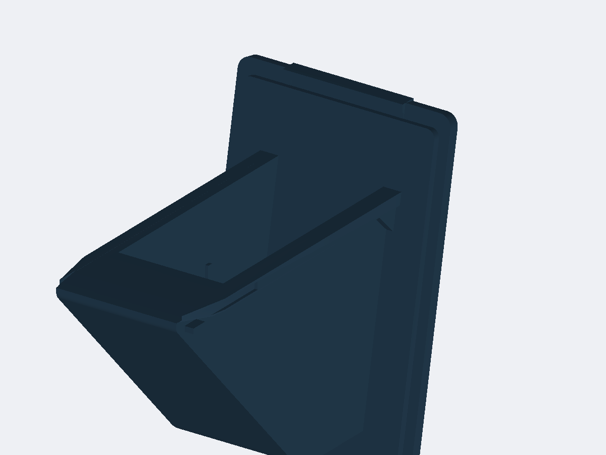
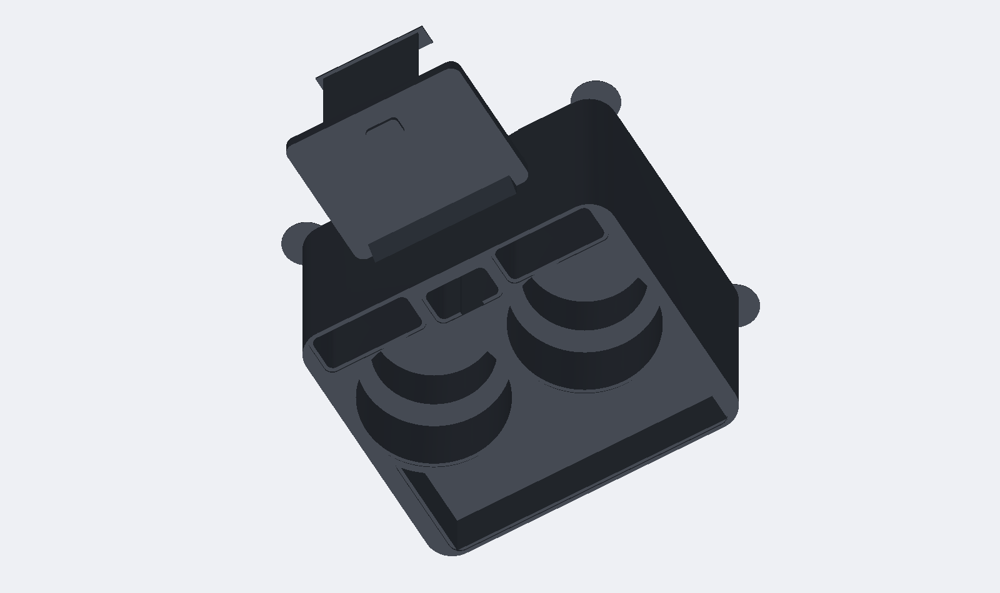
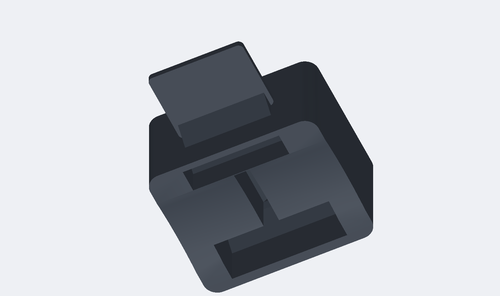
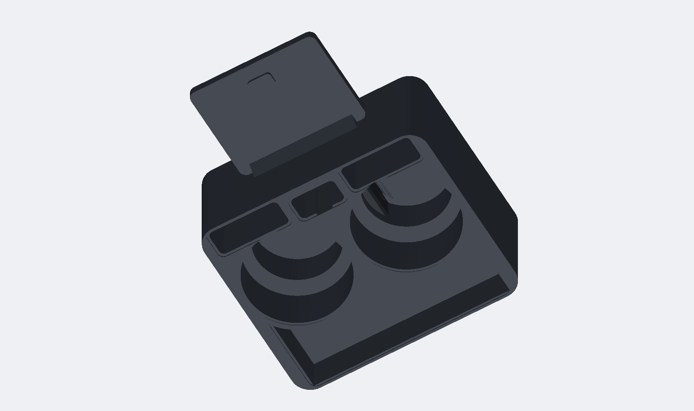
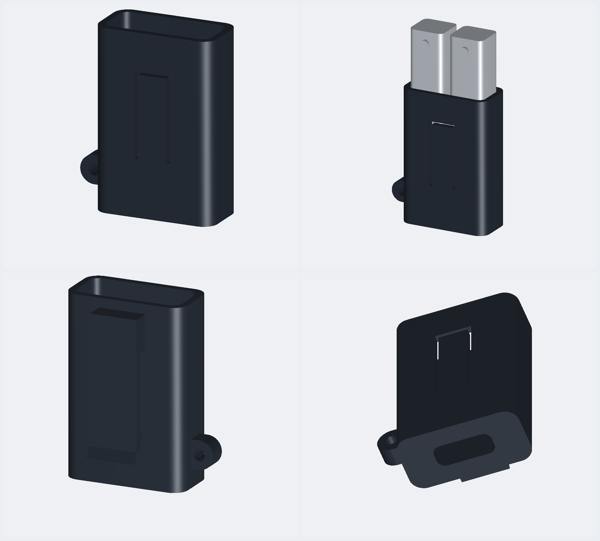

# 1994–2004 Chevy S10 & GMC Sonoma 3D Printed Accessories

A complete collection of custom, functional 3D printable upgrades designed specifically for **1994–2004 Chevrolet S10, GMC Sonoma, S10 Blazer, GMC Jimmy, and Oldsmobile Bravada** trucks and SUVs. 

Engineered and field-tested on a **1995 GMC Sonoma** (former City of Wenatchee municipal fleet truck) with factory 60/40 split bench seats.

  

  
  

  
  

---

## 🌐 Interactive 3D STL Web Inspector

Spin, pan, zoom, and inspect every model and assembly in your browser with smooth studio lighting and wireframe toggles:
* Open [`viewer.html`](viewer.html) locally or visit `http://localhost:8766/viewer.html` if the local server is running.
* **100% Offline & Private:** Built with self-contained local Three.js bundles in `js/` (zero CDNs or external network dependencies).

---

## 🚗 Vehicle Compatibility

* **1994–2004 Chevrolet S10** (Regular Cab, Extended Cab, Crew Cab)
* **1994–2004 GMC Sonoma**
* **1995–2005 Chevrolet Blazer / S10 Blazer**
* **1995–2001 GMC Jimmy**
* **1996–2001 Oldsmobile Bravada**

---

## 📦 What's Included

### 1. Dashboard Phone Mount System (17mm Ball / MagSafe / Garmin)
Located in [`stls/phone_mount/`](stls/phone_mount/)

Designed to replace the factory blanking plate / switch bezel on the dashboard to the right of the instrument cluster:

* **`sonoma_plate_monolithic_ball.stl` & `sonoma_plate_monolithic_symmetrical.stl`**:
  * **Zero Hardware Needed.** Fuses the OEM snap plate and a 17mm ball mount into a single monolithic print.
* **`sonoma_plate_metal_ball.stl` & `sonoma_plate_metal_ball_symmetrical.stl`**:
  * Designed for heavy-duty metal 17mm ball studs with a standard **1/4"-20 threaded post**.
  * Features a molded rear captive hex-nut pocket (11.5mm flats, 6mm depth) inside the reinforced boss.
* **`sonoma_plate_printed_ball.stl` & `ball_17mm_frontmount.stl`**:
  * **Front-Serviceable 2-Piece System.** Uses two front-mounted counter-bored M3 / #6 screws with captive rear nuts.
  * Allows swapping or servicing ball mounts without removing the dashboard trim bezel!

---

### 2. Dual Stepped Bench Seat Cupholder (Large Bottle & Stanley Mug)
Located in [`stls/cupholder/`](stls/cupholder/)

Solves the infamous lack of functional cupholders in 90s GM bench seat trucks:

* **`sonoma_cupholder_deck.stl`**:
  * Slides into the factory center bench seat receiver slot with a positive retention catch bump.
  * **Triple-stepped bore** holds everything from standard 12oz soda cans (2.75" bottom pocket) to Stanley 30oz/40oz tumblers, Hydro Flasks, and YETI 35oz mugs.
  * Outward-facing handle clearance notches for large travel mugs.
* **`sonoma_glide_stilt.stl`**:
  * Heavy-duty ribbed compression stilt leg that presses into the keyed socket beneath the deck.
  * Features a curved glide foot contoured to the factory transmission tunnel hump, keeping drinks completely level and rock solid under heavy braking.
  * Includes a recessed pocket on the bottom for a 1.5" felt or rubber pad to protect carpet.

---

### 3. Modular Magnetic Deep Glasses Cubby Ecosystem
Located in [`stls/dash_cubby/`](stls/dash_cubby/)

Upgrades the factory dash cavity into a deep, modular sunglasses vault with swappable magnetic faceplates:

* **`S10_cubby_magnetic_dock.stl` (140mm Deep Glasses Spec — Recommended)**:
  * Engineered with a **136.5mm internal cavity depth** (140mm total outer depth).
  * **The Sweet Spot for Glasses:** Comfortably swallows full-sized folded sunglasses (Ray-Bans, Oakleys, aviators) end-to-end, while stopping 7mm shy of the internal dashboard firewall/climate ducting so it never bottoms out behind the dash.
  * Features 4 corner boss pads with 6.3mm × 3.2mm pockets for **6mm × 3mm round neodymium disc magnets**, plus an 18mm × 10mm rear cable pass-through port.
* **`S10_cubby_magnetic_dock_147mm.stl` (147.2mm Ultra-Deep Spec)**:
  * Maximum theoretical depth matching the original `S10_glasses_cubby_deep.stl` for trucks with full rear cavity clearance.
* **`S10_cubby_mag_ball_plate.stl` (Magnetic 17mm Ball Mount Plate)**:
  * Snaps firmly onto the magnetic dock with 4 matching neodymium magnets.
  * Features a rigid 17mm ball mount stud on a reinforced keel, tilted 15° upward toward the driver.
  * Allows popping off in one second with the bottom finger notch to access your sunglasses, then snapping right back on!
* **`S10_cubby_mag_stealth_cover.stl` (Flush OEM Stealth Stash Lid)**:
  * Completely conceals the deep cubby behind a factory-looking blank bezel with a bottom finger-lift notch.
  * 4 rear magnet pockets are hidden behind a 0.3mm solid front skin, creating an undetectable secret stash vault.
  * Inset anti-rattle locating rim keys securely into the cubby opening to prevent any vibration while driving.
* **`S10_cubby_mag_magsafe_plate.stl` (Magnetic 15° MagSafe Fast-Charger)**:
  * Holds standard 56mm Apple MagSafe / Qi2 wireless charging pucks tilted 15° toward the driver, with an internal USB-C wiring channel.

#### 🕶️ Classic Open Dash Trays
* **`S10_glasses_cubby_deep.stl`**: Original open full-depth sunglasses box (147mm).
* **`S10_glasses_cubby_angled.stl`**: Original angled sunglasses tray.
* **`S10_dash_cubby.stl`**: OEM replacement insert.

---

### 4. Ashtray Conversions (Power & Storage)
Located in [`stls/ashtray/`](stls/ashtray/)

Replaces the unused factory cigarette ash bin with high-power USB-C charging stations, full slide-out cargo drawers, or dedicated EDC drop-in organizers:

  

  <em>Figure: 1994–1997 GMC Sonoma / Chevy S10 True Replacement Wedge Drawer (GM Part # 15698461): (Left) 3/4 Isometric view showing the tall tilted faceplate with recessed 8-rib finger pull and deep 80mm cargo vault; (Center) True side profile showing the calibrated 11.14° rearward faceplate slant, top slide rails, and 47.3° upward wedge ramp clearing the lower HVAC duct; (Right) Underside 3/4 view showing the ceiling slide rails, lead-in chamfers, retention stop lugs, and bezel step.</em>

#### 📐 1994–1997 Lower Dash Cavity & True Wedge Geometry
Reverse-engineered directly from factory GM part **`15698461`** (`PP PF J3`) and calibrated using photogrammetry against physical Milwaukee Fastback scale references:

| Metric | Factory Ashtray Drawer (GM 15698461) | True Replacement Wedge Drawer (`sonoma_1995_true_wedge_drawer.stl`) |
|---|---|---|
| **Outer Faceplate** | $90.5\text{mm W} \times 134.0\text{mm H}$ ($11.14^\circ$ rearward tilt) | **$90.5\text{mm W} \times 134.0\text{mm H} \times 4.5\text{mm T}$** ($11.14^\circ$ tilt, $5\text{mm}$ radiused corners) |
| **Top Finger Pull** | Recessed ribbed scallop under top overhang lip | **Recessed $38\text{mm} \times 24\text{mm}$ thumb pocket with 8 vertical grip ribs** |
| **Slide Rails (Ceiling)** | $60.0\text{mm}$ span across rails, $5.2\text{mm}$ thick, $138.0\text{mm}$ length | **$60.0\text{mm}$ rail width, $4.8\text{mm}$ thick ($0.4\text{mm}$ glide clearance), $23\text{mm}$ Easy-Slide funnel** |
| **Self-Aligning Guidance** | Blunt ends (difficult to blind-mate in dash) | **$23\text{mm}$ horizontal tapers (narrows to $51\text{mm}$) + vertical ski-ramp tips (funnels right into tracks)** |
| **Dash Spring Interface** | Flat rear shelf (can snag or stub) | **$15^\circ$ ceiling spring compression ramp + $40^\circ$ interior anti-snag transition ramp** |
| **Retaining System** | Stamped metal leaf spring clip ($28\text{mm}$ slot) | **Integrated 3D printed $20^\circ$ ramp / $75^\circ$ stop lugs + OEM metal clip slots** |
| **Body Width & Depth** | $51.0\text{mm}$ body width, drops $86.5\text{mm}$ at front | **$51.0\text{mm}$ outer body, $86.5\text{mm}$ max depth, $52\text{mm}$ flat floor** |
| **HVAC Duct Clearance** | $47.3^\circ$ bottom upward wedge ramp to rear tip | **$47.3^\circ$ bottom slope with filleted transition ($R=18\text{mm}$)** |
| **Internal Cargo Vault** | Snuffer plate & divider (effectively $\sim 40\text{ cm}^3$ usable) | **Wide-open vault: $44.6\text{mm W} \times 80.5\text{mm D} \times 105.0\text{mm L}$ ($324\text{ cm}^3$, >8x volume!)** |

  

  <em>Figure: Self-Aligning Easy-Slide System: (1) 23mm horizontal funnel narrowing the rail tips to 51mm, (2) vertical ski-ramp bevels preventing channel stubbing, (3) ceiling spring compression ramp, and (4) 40° interior anti-snag ramp.</em>

##### 🧰 What Fits in the True Wedge Drawer:
* **✅ Fits Comfortably:**
  * **Everyday carry pocket knives & utility cutters** (Milwaukee Fastback 6-in-1, Benchmade Bugout, Spyderco PM2 stand upright or lay flat).
  * **Full-size folded sunglasses** (Ray-Ban Wayfarers/Aviators, Oakley Gascan slide directly into the rear sloped bay).
  * **Smartphones tilted in front pocket** (Pixel, standard iPhone sit upright securely in the $80.5\text{mm}$ deep front pocket).
  * **Multi-tools** (Leatherman Wave+, Charge, SOG PowerPint).
  * **Wireless earbud cases** (AirPods Pro, Galaxy Buds, Pixel Buds).
  * **Key rings & garage clickers** (Chamberlain remotes, bulky GM truck fobs).
  * **Loose coins & small hardware** (slides effortlessly into your fingers via the integrated $45^\circ$ front scoop ramp).

---

#### 🛠️ The 1994–1997 Ashtray Suite Models:

1. **`sonoma_1995_true_wedge_drawer.stl` (True OEM Replacement Slide-Out Drawer)**:
   * **100% physically accurate reproduction** of factory GM part `15698461`.
   * Replaces broken, missing, or cigarette-ruined factory drawers with zero dash modifications.
   * Slides directly into the factory ceiling metal C-channel tracks.
   * Eliminates the dirty cigarette snuffer divider to create a massive single $324\text{ cm}^3$ cargo vault.
   * Backwards-compatible duplicate exported as `sonoma_1995_ashtray_vault_drawer.stl`.

2. **`sonoma_1995_ashtray_charging_plate.stl` (Heavy-Duty Dual USB-C Cockpit Faceplate)**:
   * Deletes the sliding drawer in favor of a rigid, vibration-proof dash faceplate locked directly into the factory slide channels.
   * **Left Socket:** Precision $28.8\text{mm}$ ($1\text{-}1/8"$) round socket for universal automotive/marine high-power Dual USB-C Power Delivery ($45\text{W}/65\text{W}$) + QuickCharge 3.0 chargers with integrated digital LED voltmeters.
   * **Right Cutout:** Standard $21.0\text{mm} \times 36.8\text{mm}$ automotive rectangular rocker switch cutout (for auxiliary off-road lights, master USB power cutoff, air compressor, or dashcam bypass).
   * Generous rear wire pass-through cavity directly accessing the factory $12\text{V}$ power harness.

3. **`sonoma_1995_ashtray_stock_organizer.stl` (Stock Blue Drawer Drop-In Organizer)**:
   * **Zero exterior modifications:** Keeps your $100\%$ original factory dark blue faceplate and sliding drawer intact.
   * Unclip the factory sheet-metal cigarette snuffer flap and drop this dual-compartment organizer directly inside.
   * **Front Compartment:** Smooth $45^\circ$ coin scoop ramp + key ring slot.
   * **Rear Compartment:** Deep utility vault ($48\text{mm L} \times 53\text{mm W} \times 36\text{mm D}$) for AirPods, folded bills, USB flash drives, or security tokens.

4. **`sonoma_1995_lighter_usbc_adapter.stl` (12V Cigarette Lighter to Dual USB-C Adapter Bushing)**:
   * Precision collar that converts the factory round $12\text{V}$ cigarette lighter opening located directly to the right of the ashtray.
   * **Cabin Facing:** $38.0\text{mm}$ outer diameter dash trim bezel with a $29.0\text{mm}$ inner bore ($22.0\text{mm}$ depth) to firmly house standard $1\text{-}1/8"$ marine USB-C fast chargers.
   * **Dash Facing:** $21.5\text{mm}$ keyed cylindrical stem with anti-rotation lock flat that inserts directly into the factory GM $22\text{mm}$ dash hole without cutting, filing, or drilling the original dashboard!
   * $14.0\text{mm}$ through-hole allows power/ground wires and spade terminals to pass freely to the factory harness.

---

#### 1998–2004 Models (Center Stack Below HVAC):
Located in the center dash stack. Compatible with both drop-in bin inserts and flush delete pods:
* **`S10_ashtray_usb_power_panel.stl`**: Center-stack 28.8mm USB-C panel.
* **`S10_ashtray_deep_pocket.stl`**: Multi-compartment coin/key drop pocket.
* **`S10_ashtray_combo_power_pocket.stl`**: 2-in-1 hybrid power and storage bin.

---

### 5. 1995 Sonoma Bench Seat Cupholder Upgrades
Located in [`stls/cupholder/`](stls/cupholder/)

  
  

  
  

Calibrated directly against real photos of the **1995 GMC Sonoma** dark blue interior and verified using a **Milwaukee Fastback 6-in-1 (`48-22-1505`)** utility knife (117mm / 4.6" closed) as a physical scale:

* **Real Floor Drop Clearance:** The distance from the seat receiver tongue down to the rubber transmission tunnel floor mat is only **50mm to 60mm (~2.0" to 2.4")**. The bottom of full-depth 82mm cups sits just ~25mm above the floor mat, making the support stilt leg extremely short, rigid, and rock-solid!

#### 🚀 1. The Monolithic Unibody Console — Dual Big-Pocket Edition (Recommended)
Replaces the stock GM blue cupholder console entirely as a **100% single, solid automotive unibody** maximizing cargo volume and daily-carry utility with wide-open, deep storage pockets and zero slicing artifacts:

* **`sonoma_1995_monolithic_console.stl`**:
  * **Dual 82mm-Deep Stepped Cupholders:** Over **2.3x deeper** than the stock 35mm GM wells! Complete 360° circular solid perimeter walls with a stepped bore (86mm / 3.38" top flare down to 54mm depth, 70mm / 2.75" lower pocket down to 82mm depth). Holds standard 12oz soda cans and water bottles firmly without rattle, while seating 30oz/40oz tumblers (Yeti 35oz, Stanley 40oz, Hydro Flask) deeply (57.5mm / 2.26" deep) for extreme tip-resistance under hard braking.
  * **Deep Rear Utility Vault:** Precision cargo well ($52\text{mm W} \times 22\text{mm L} \times 55\text{mm D}$) centered in the rear bridge behind the cups. Sized generously to swallow multi-tools (Leatherman Wave/Surge), folding utility knives (Milwaukee Fastback 48-22-1505), pliers, EDC flashlights, or key rings standing upright with zero tipping risk, while preserving thick $>4.0\text{mm}$ solid bulkheads.
  * **Massive Forward Cargo Mega-Bay:** Wide-open, cavernous storage bay ($166\text{mm W} \times 47\text{mm L} \times 30\text{mm D}$) spanning across the full forward console deck. Completely open unibody architecture (no tiny slots or restrictive dividers) designed to fit large smartphones (iPhone Pro Max, Galaxy Ultra) laying flat or propped at an angle, full-size sunglasses cases, wallets, tape measures, or large hand tools.
  * **Continuous 45° Coin Scoop Ramp:** Full-width angled ramp integrated seamlessly along the leading front wall for effortless slide-out retrieval of coins, guitar picks, and small hardware.
  * **Ergonomic Front-Lip USB-C Cable Scallop:** $10\text{mm}$ contoured cable relief notch centered on the forward lip for snag-free charging cord pass-through directly from the lower dash/ashtray USB ports.
  * **100% Solid Floor & Tunnel Arch (Zero Floating Holes):** Every tool well, pocket, and cup has thick solid plastic beneath it (15mm to 68mm solid floor margin to bed). No hollow coring cavities, no unsupported voids, and zero staticy collar lines.
  * **Reinforced Seat Receiver Tongue with 45° Cammed Retention Catch & Buttress Gusset:** 
    * Eliminates cantilever bending fatigue when resting heavy tumblers or leaning on the console.
    * Features a heavy-duty **45° triangular buttress gusset** underneath that tapers smoothly from $Y = -78\text{mm}$ down into the vertical rear body wall.
    * Taper acts as a self-centering 45° lead-in shoe that slides effortlessly into the seat receiver slot without catching.
    * Features a **45° top transition fillet** that eliminates notch stress concentration where the tongue meets the console deck.
    * Integrated retention catch bump features a **45° smooth cam lead-in ramp** on its leading edge, gliding effortlessly into the factory GM receiver channel like a door latch bolt without hanging up on bracket edges.
  * **Integrated Transmission Tunnel Glide Base & Anti-Warp Bed Architecture:**
    * **Longitudinal Transmission Tunnel Arch:** Rotated and calibrated along the Y-axis (front-to-back) to follow the real chassis tunnel hump.
    * **Eliminated 9° Feather Edge:** Arch cutout is bounded ($|X| \le 46\text{mm}$) with a distinct $1.2\text{mm}$ vertical landing shoulder, completely eliminating razor-thin feather edges that cause cooling warping and bed peeling.
    * **Broad Flat Bed Landing Runners:** 52mm-wide continuous flat contact runners on both driver and passenger sides, providing massive bed adhesion surface area.
    * **Integrated Sacrificial Corner "Mouse Ears":** 4 built-in $28\text{mm} \times 0.45\text{mm}$ (2-layer) breakaway adhesion discs on the extreme base corners to pin the console against thermal contraction during ASA cooling. Snaps off cleanly by hand after printing.
    * **Breakaway Tongue Support Kickstand Truss:** Includes an engineered $1.2\text{mm}$ sacrificial kickstand wall with a $0.35\text{mm}$ breakaway air gap supporting the $85\text{mm}$ cantilevered tongue all the way to the build plate ($Z = -110\text{mm}$). Ensures the tongue never sags or vibrates during long prints and snaps off effortlessly by hand.
    * **Dual Recessed Felt Pockets:** Two 40mm circular pockets centered on the flat runners ($X = \pm 68\text{mm}$) for anti-slip rubber or felt pads.

#### 🧩 2. The Modular 2-Piece Edition (Zero-Rattle & Anti-Binding Calibrated Fit):
* **`sonoma_cupholder_1995_megadeck.stl`**:
  * The same dual big-pocket console deck, stopping at $Z = -85\text{mm}$ with an underside calibrated mortise socket ($22\text{mm} \times 50\text{mm}$) ensuring zero interference with the lower cupholder pockets.
  * **Self-Centering Socket Mouth:** Features a $1.5\text{mm}$ $45^\circ$ lead-in chamfer around the socket entrance for smooth tenon engagement.
* **`sonoma_cupholder_1995_stilt_26mm.stl` (25mm Low-Profile Stabilizer Foot)**:
  * **Calibrated 0.20mm Sliding Tolerance:** Sized with exact $0.20\text{mm}$ per-side clearance based on real-world community testing ($21.6\text{mm} \times 49.6\text{mm}$ tenon).
  * **Corner Seam Relief:** Tenon corners engineered with a generous $4.0\text{mm}$ radius for guaranteed relief against printer corner zits or layer seams.
  * **45° Lead-in Insertion Chamfer:** $2.5\text{mm}$ lead-in taper at the tenon tip for effortless, self-aligning insertion without catching.
  * **4 Tapered Anti-Rattle Crush Ribs:** Vertical ribs along the center of each face tapering from $0.0\text{mm}$ at the top to $+0.35\text{mm}$ interference at the base collar. Slides in freely for the first 75% of travel, then wedges firmly into the socket during the final $4\text{mm}$ for $100\%$ rock-solid lockup with **ZERO rattle** and **ZERO sanding needed**!
  * **Foot Anti-Warp Anchor Discs:** 4 built-in $22\text{mm} \times 0.45\text{mm}$ breakaway mouse ears on the stilt foot corners.

#### 🛠️ 3. OEM Dual-Well Drop-In Inserts (Zero Disassembly Option):
* **`sonoma_cupholder_tumbler_sleeve.stl` (30/40oz Stanley & Yeti Riser)**:
  * Drops directly into either factory blue cup well.
  * Features a 35mm lower seating collar that locks into the OEM well, rising 50mm above the console with a **stepped 3.25" / 3.62" bore** and a wide outward **mug handle slot**.
* **`sonoma_cupholder_fastback_caddy.stl` (Milwaukee Fastback + Phone Caddy)**:
  * Drops into one of the blue wells to convert it into a specialized EDC workstation.
  * Features a precision **vertical pocket custom-molded for the Milwaukee 48-22-1505 Fastback knife** plus a smartphone / battery bank slot.
* **`sonoma_glide_stilt_52mm.stl`**:
  * Calibrated 52mm stilt leg for the original flat-deck cupholder.

---

### 6. Tactical EDC Gear & Scan-Molded Accessories
Located in [`stls/accessories/`](stls/accessories/)

Custom accessories reverse-engineered and form-fitted directly around real-world 3D photogrammetric scans:

  

  <em>Figure: Stanley 12-in-1 Multitool Tactical EDC Sheath: (Top-Left) 3/4 Front Isometric view showing the compliant cantilever spring finger with flush outer profile and lower 550 paracord loop; (Top-Right) Seated EDC Assembly showing the multitool locked inside with 33mm exposed handle for one-handed draw; (Bottom-Left) 3/4 Rear view showing the 1.75" heavy-duty belt clip with reinforcing bridge gusset, retention barb, and ski-ramp lead-in; (Bottom-Right) Underside view showing the 24mm x 10mm index-finger quick-draw push-up port and drainage slot.</em>

* **`stanley_multitool_tactical_sheath.stl` (Stanley 12-in-1 Tactical EDC Belt Sheath)**:
  * **Photogrammetric Scan Reverse-Engineered:** Custom-molded from a 3D surface scan (`3DModel.obj`) of the Stanley 12-in-1 / 14-in-1 multi-tool.
  * **Calibrated 0.6mm Glide Clearance:** Form-fitting $45.0\text{mm W} \times 19.6\text{mm T} \times 72.0\text{mm D}$ cavity holds the tool firmly with zero rattle while sliding smoothly without binding.
  * **Active Cantilever Click-Lock Retention Detent:** An engineered $12\text{mm} \times 36\text{mm}$ flexible spring finger on the front face carries an inward hemispherical detent bead at $Z = 52\text{mm}$ that snaps into the multi-tool's skeletonized handle cutout with an audible, tactile click.
  * **Snag-Free Flush Exterior:** The retention bead is clamped flush to the front wall, eliminating external bumps so the holster slips cleanly in and out of pockets.
  * **Integrated 1.75" (45mm) Heavy-Duty Belt Clip:** Fits thick leather gun belts and tactical nylon webbing ($5.2\text{mm}$ clearance gap) with an inward retention barb to lock onto the belt bottom, an outward $45^\circ$ ski-ramp for easy one-handed clipping, and a $45^\circ$ triangular bridge gusset preventing delamination.
  * **Index-Finger Quick-Draw Port & Drainage Slot:** Open $24\text{mm} \times 10\text{mm}$ floor cutout allows popping the tool up instantly with an index finger, while allowing dust, lint, and water to drain freely.
  * **Lower Corner 550 Paracord Eyelet:** Reinforced $5.0\text{mm}$ horizontal through-hole at the base corner for tethering, carabiners, or dummy-cording without snagging draw access.

---

### 7. 💡 Dashboard & Glove Box LED Bulb Upgrade Guide

The factory incandescent miniature wedge bulbs in the lower dash ashtray and the passenger glove box drawer often burn out or emit a dim yellow glow. Both can be easily upgraded to high-efficiency, bright LEDs.

#### 📐 Bulb Specifications:
* **Lower Dash Ashtray Light:** **#161 or #194 (T10 / W5W miniature wedge base)** (12V, push-in wedge).
* **Passenger Glove Box Drawer Light:** **#194 (T10 / W5W miniature wedge base)** (12V, push-in wedge).
* **Recommended Replacement:** High-quality CANBus-friendly **T10 / 194 LED wedge bulbs** (available in Warm White 3000K for an OEM look, Cool White 6000K for modern clarity, or Dark Blue to complement the factory Sonoma blue interior).

#### 🔧 Step-by-Step Replacement:
1. **Ashtray Night-Light:**
   * Slide the ashtray drawer out. Press down on the top spring release tab and pull the inner bucket out.
   * Look directly into the upper ceiling of the inner dash cavity. You will see a small twist-lock plastic socket.
   * Twist the socket **1/4 turn counterclockwise** to unlock and pull it down.
   * Pull the old glass #161/#194 bulb straight out of the wedge socket. Push the new LED bulb straight into the socket.
   * **Polarity Check:** Turn on your parking lights. If the LED doesn't illuminate, pull it out, **flip it 180 degrees**, and reinsert (LED diodes are polarity-sensitive).
   * Twist the socket clockwise 1/4 turn back into the housing ceiling.
2. **Passenger Glove Box Drawer Light:**
   * Open the glove box door. Locate the striker/light assembly on the upper frame.
   * Gently squeeze the plastic diffuser lens tabs to release the lens cover.
   * Pull the old #194 wedge bulb straight out and push the new LED in.
   * Verify illumination when opening the glove box door (flip 180° if needed), then snap the lens cover back into place.

## ⚡ Step-by-Step Ashtray & Cigarette Lighter Wiring Guide

Because the factory 12V cigarette lighter is located right next to the ashtray, you have clean, direct access to power without running wires through the firewall.

### 🔍 GM Factory Wire Identification:
When you pull the lower dash trim / center bezel forward to access the back of the lighter socket, you will see two or three factory wires:
1. **ORANGE (12–14 AWG thick wire)**: **Constant 12V+ Battery Power** (Hot at all times, even with key out of the ignition). Protected by the 20A / 25A `CIG` or `AUX PWR` fuse in the driver's side fuse panel.
2. **BLACK (16–18 AWG wire)**: **Chassis Ground (12V-)**. *(Note: On some S10s, the lighter grounds directly through its outer metal collar or metal dash bracket; in that case, ground your new USB charger to any metal bolt on the dash frame).*
3. **GRAY (18 AWG thin wire, if equipped)**: **Dash Illumination (12V+)**. Only powers the tiny factory light bulb when headlights or parking lights are turned ON. *(Do NOT use this wire to power your USB charger—it cannot support the amperage and will blow the instrument cluster fuse).*

---

### 🛠️ Wiring Options: Constant Power vs. Ignition-Switched

#### Method A: Tapping the Factory Cigarette Lighter (Constant 12V Power — Easiest)
* **How it works:** Connect the USB socket's `(+)` terminal to the factory **ORANGE** wire using an insulated T-Tap or solder-and-heat-shrink splice. Connect `(-)` to the **BLACK** wire (or a ring terminal to a nearby dash bolt).
* **Advantage:** Your phone or MagSafe charger charges even when the truck is parked and the key is in your pocket (great for camping, road trips, or quick errands).
* **Important Precaution:** If you buy a USB socket with an always-on LED voltmeter, it will draw a tiny "vampire" standby current (approx 15–25mA). While negligible for a daily driver, if the truck sits parked for 3–4 weeks, it can slowly discharge the battery. **Recommendation:** Buy a USB socket that has an integrated **touch on/off switch** on the front lens so you can turn the display off when parked!

#### Method B: Ignition-Switched 12V (Turns ON/OFF with the Key — Recommended for Voltmeter Sockets)
If you want the charger and voltmeter display to shut off 100% when you turn off the truck:
1. Open the driver's side dash fuse box (accessible with the driver door open).
2. Use a standard **Add-a-Circuit / Add-a-Fuse tap** (ATO or Mini fuse depending on your year) into an ignition-switched fuse slot (such as `WPR` Windshield Wipers or `RADIO`).
3. Insert the original fuse into the bottom slot of the tap, and a **10A fuse** into the top slot for your new USB charger.
4. Route a single 16 AWG power wire from the tap, behind the knee bolster, and into the center ashtray cavity. Connect to the `(+)` terminal of the USB socket.
5. Connect the `(-)` terminal to any clean metal screw or bolt on the inner dash frame.

---

## 🔩 Hardware Required (Optional Depending on Module)

* **For Magnetic Cubby Faceplates:**
  * 4x to 8x standard **6mm diameter × 3mm thick round neodymium disc magnets** (Grade N50 or N52 recommended for maximum holding power). Press-fit with a dab of superglue / CA glue.
* **For Metal Ball Phone Mount:**
  * 1x 17mm metal ball stud with 1/4"-20 threaded shank and matching 1/4"-20 hex nut.
* **For 2-Piece Serviced Mount:**
  * 2x M3 × 16mm socket head cap screws and 2x M3 hex nuts.

---

## 🖨️ Recommended Print Settings

> [!IMPORTANT]
> **Material Warning:** Because car interiors in the summer can easily exceed **60°C to 70°C (140°F – 160°F)**, **DO NOT USE STANDARD PLA**! PLA will deform, soften, and warp in hot vehicles.

* **Recommended Filament:** **PETG**, **ABS**, or **ASA** (ASA is ideal for UV and heat resistance).

### 🚀 Monolithic Console Slicing Guide (Maximum Strength, Minimum Time & Filament)
* **Print Orientation:** Flat on build plate (Z up).
* **Supports:** **DISABLED / OFF**! (All cavity ceilings, bevels, and buttresses are 45° self-supporting).
* **Layer Height:** 
  * `0.28mm` (Fast profile with standard 0.4mm nozzle) — cuts print time by **~40%** vs 0.20mm while looking great.
  * `0.32mm` or `0.36mm` (with 0.6mm nozzle) — cuts print time by **~60%** (prints in ~10–12 hours instead of 28 hours!).
* **Perimeters / Wall Line Count:** `3 to 4 walls` (1.2mm to 1.6mm wall thickness).
  * *Strength Tip:* In 3D printing mechanics, >90% of bending and impact resistance comes from outer perimeters. 3–4 walls provide extreme structural rigidity.
* **Infill:** `12% to 15% Gyroid` or `Adaptive Cubic / Lightning`.
  * *Filament Saver:* Higher infill (e.g. 40–50%) wastes hundreds of grams of filament and adds 10+ hours without contributing meaningful real-world strength. 15% Gyroid provides uniform 3D compression resistance.

### 📱 Dash Phone Mounts & Ashtray Inserts
* **Layer Height:** `0.20mm` (or `0.16mm` for ball studs).
* **Perimeters / Walls:** `4 to 5 walls` (Crucial for mechanical strength on phone ball stems).
* **Infill:** `25% to 40% Gyroid`.
* **Supports:**
  * Phone plates: Print flat face-down on build plate. Supports required only under the rear snap tabs.
  * Ball stud (`ball_17mm_frontmount.stl`): Print oriented on its flat side for maximum layer adhesion strength along the stem axis.
  * Ashtray inserts: Print right-side up with 0 supports.

---

## 💻 Parametric CAD Source Code

All parts were programmatically designed in Python using the modern `manifold3d` geometric modeling engine. Source scripts are in [`src/`](src/):
* `src/generate_monolithic_console.py`: 1995 Sonoma Monolithic Unibody Console & 25mm stilt generator.
* `src/generate_1995_true_wedge_drawer.py`: 1994–1997 True Wedge OEM replacement drawer generator.
* `src/generate_stanley_multitool_sheath.py`: Stanley 12-in-1 Multitool Tactical EDC Sheath generator.
* `src/render_stanley_sheath.py`: Multi-view studio CAD rendering pipeline for tactical sheath.
* `src/generate_1995_sonoma_cupholder_console.py`: 1995 Sonoma Mega-Deck console & 26mm stabilizer stilt generator.
* `src/generate_1995_sonoma_mods.py`: 1995 Sonoma ashtray drop-ins, tumbler sleeve, Fastback caddy, and 52mm stilt generator.
* `src/generate_all_phone_mounts.py`: Parametric phone mount generator.
* `src/generate_sonoma_cupholder.py`: Bench cupholder and original stilt generator.
* `src/generate_cubby_mods.py`: Modular magnetic dash cubby and accessories generator.
* `src/generate_ashtray_mods.py`: Ashtray power panel and deep pocket conversion generator.
* `src/render_1995_sonoma.py`: Studio CAD rendering script for 1995 Sonoma models.
* `src/render_smooth_cad.py`: Phong studio CAD rendering pipeline.
* `src/export_symmetrical_mounts.py`: Symmetrical plate exports.

You can modify cup diameters, stilt drop heights, or ball tilt angles directly in the Python scripts!

---

## 📄 License

This project is licensed under the [MIT License](LICENSE) — free to print, modify, and share.
